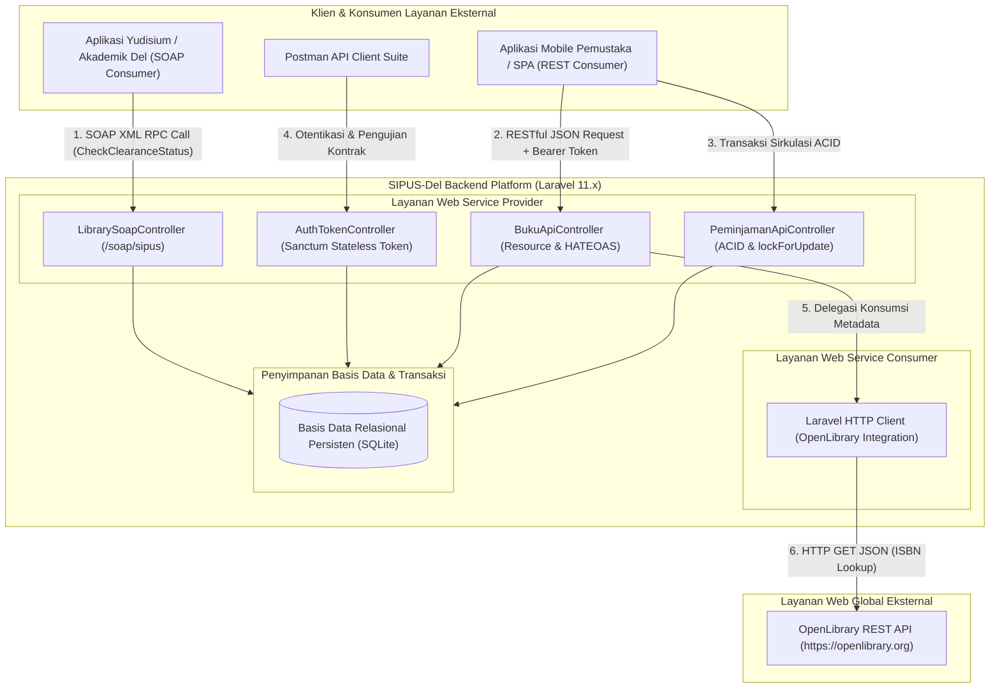

# Sistem Informasi Perpustakaan Kampus Del (SIPUS-Del)
**Praktikum Pemrograman & Pengujian Web (12S3101) — Modul Minggu 09 (Tahap 3)**  
*Institut Teknologi Del • Semester Ganjil 2026/2027*

---

## 👨‍💻 Identitas Mahasiswa

| Informasi | Keterangan |
| :--- | :--- |
| **Nama Lengkap** | **Arion Manurung** |
| **NIM** | **12S24014** |
| **Program Studi** | Sarjana Sistem Informasi / Informatika |
| **Institusi** | Institut Teknologi Del, Sitoluama, Laguboti, Toba |
| **Mata Kuliah** | Pemrograman & Pengujian Web (12S3101) |
| **Branch Git** | `week9-rest-api` |

---

## 📌 Ringkasan Eksekutif Pengembangan (Tahap 3)

Pada **SIPUS-Del Tahap 3**, arsitektur aplikasi berevolusi dari sistem monolitik berbasis web antarmuka Blade menjadi **Arsitektur Web Services Terdistribusi Heterogen (Hybrid SOAP & RESTful Web API)**:
1. **Layanan Legacy SOAP (SOAP Provider)**: Menyediakan kontrak formal XML berbasis WSDL (`/soap/sipus.wsdl` dan `/soap/sipus`) untuk layanan *Check Clearance Status* (Bebas Pustaka) yang dapat dikonsumsi oleh sistem akademik/yudisium kampus Del.
2. **RESTful Web API Provider Berstandar Industri (Richardson Maturity Model Level 3)**:
   - **Otentikasi Stateless Token**: Dipersenjatai **Laravel Sanctum v4** dengan mekanisme penerbitan dan pencabutan Bearer Token tanpa bergantung pada sesi server (`auth:sanctum`).
   - **Transformasi Representasi & HATEOAS Dinamis**: Menggunakan `JsonResource` (`BukuResource` dan `PeminjamanResource`) yang menginjeksi kontrol navigasi hypermedia `_links` secara dinamis berbasis state riil entitas (contoh: tautan `pinjam_buku` otomatis hilang jika stok = 0; tautan `kembalikan_buku` otomatis hilang jika status telah dikembalikan).
   - **Perbedaan Semantik Representasi HTTP (PUT vs PATCH)**: Mendemonstrasikan penggantian representasi penuh (*Full Replacement*) via `PUT` dan pembaruan sebagian atribut (*Partial Update*) via `PATCH`.
3. **Standarisasi Representasi Galat RFC 7807 (Problem Details for HTTP APIs)**: Seluruh respons kesalahan API (401 Unauthorized, 404 Not Found, 409 Conflict, 422 Unprocessable Entity) diseragamkan dengan tipe media `application/problem+json` dan struktur `{type, title, status, detail, instance}`.
4. **Transaksi Sirkulasi Sirkuler Atomik Berbasis ACID & Pessimistic Locking (`lockForUpdate`)**: Mutasi stok buku dan pencatatan peminjaman/pengembalian terlindungi transaksi terisolasi dengan penguncian baris basis data, mencegah *Race Condition* dan anomali persaingan akses konkuren.
5. **Integrasi REST API Consumer (OpenLibrary)**: SIPUS-Del berperan sebagai klien API eksternal yang mengonsumsi metadata publik OpenLibrary secara *real-time* via `Illuminate\Support\Facades\Http`.
6. **Kontrak Resmi OpenAPI 3.0 & Koleksi Uji Postman v2.1**: Dokumentasi spesifikasi mesin-terbaca (`docs/openapi-sipus-v1.yaml`) dan artefak uji otomatis (`docs/SIPUS-Del-API-v1.postman_collection.json`).

---

## 🏛️ Analisis Arsitektur Layanan Web Terdistribusi

### 1. Arsitektur Provider vs Consumer pada SIPUS-Del



- **SIPUS-Del sebagai Web Service Provider**: Menyediakan fungsionalitas inti perpustakaan (katalog, status bebas pustaka, dan sirkulasi) kepada pihak luar dengan protokol terstandarisasi. Sebagai provider, SIPUS-Del bertanggung jawab menjaga integritas data, validasi input, otentikasi stateless, dan isolasi konkurensi.
- **SIPUS-Del sebagai Web Service Consumer**: Mengambil peran sebagai klien (*consumer*) yang mengonsumsi layanan pihak ketiga (OpenLibrary) untuk memperkaya informasi katalog lokal tanpa harus mengelola metadata penerbitan buku sedunia secara manual.

---

### 2. Analisis Komparatif: Layanan SOAP vs RESTful Web API

| Dimensi Arsitektur | SOAP (Simple Object Access Protocol) | REST (Representational State Transfer) | Implementasi Nyata pada SIPUS-Del |
| :--- | :--- | :--- | :--- |
| **Filosofi Inti** | *Protocol / Remote Procedure Call* (RPC) berorientasi operasi/fungsi (*Action-oriented*). | Gaya Arsitektur (*Architectural Style*) berorientasi sumber daya (*Resource-oriented*). | SOAP: Mengeksekusi fungsi `CheckClearanceStatus`.<br>REST: Memanipulasi *resources* `/bukus` dan `/peminjamans`. |
| **Format Pertukaran Data** | Eksklusif berbasis **XML** dengan struktur wajib `<soapenv:Envelope>`, `<Header>`, dan `<Body>`. | Fleksibel: Utamanya **JSON**, XML, HTML, atau teks polos. | SOAP: XML Envelope + `<soap:Fault>`.<br>REST: Payload JSON bersih + RFC 7807 `application/problem+json`. |
| **Protokol Transportasi** | Independen dari protokol transport: Mendukung HTTP/HTTPS, SMTP, TCP, JMS. | Terikat erat pada protokol aplikasi **HTTP/HTTPS** dengan memanfaatkan kata kerja (*verbs*). | SOAP: Rute POST `/soap/sipus`.<br>REST: Pemanfaatan semantik HTTP `GET`, `POST`, `PUT`, `PATCH`, `DELETE`. |
| **Kontrak Layanan** | Sangat ketat dan formal menggunakan dokumen **WSDL** (*Web Services Description Language*). | Deklaratif & deskriptif menggunakan spesifikasi **OpenAPI (OAS 3.0)** atau Hypermedia (HATEOAS). | SOAP: Kontrak WSDL resmi di `/soap/sipus.wsdl`.<br>REST: Kontrak OpenAPI di `docs/openapi-sipus-v1.yaml`. |
| **Ukuran Overhead & Kinerja** | *High Overhead*: Memerlukan pembungkus tag XML yang panjang dan proses parsing XML intensif. | *Lightweight*: Struktur JSON ringkas, *parsing* sangat cepat, hemat alokasi memori & bandwidth jaringan. | REST menghasilkan waktu respons lebih cepat untuk perangkat mobile dan aplikasi berkinerja tinggi. |
| **Manajemen State (Statefulness)** | Dapat dirancang *Stateful* maupun *Stateless* tergantung arsitektur server. | **Wajib Stateless**: Setiap permintaan harus memuat seluruh konteks otentikasi secara mandiri. | REST menggunakan header `Authorization: Bearer <token>` tanpa sesi server. |
| **Penanganan Kesalahan** | Standar XML `<soap:Fault>` berisi `<faultcode>` dan `<faultstring>`. | Pemanfaatan *HTTP Status Codes* (400, 401, 404, 409, 422, 500) didukung standar **RFC 7807**. | SOAP: `<soap:Fault>` kode 500.<br>REST: Status code semantik + objek Problem Details seragam. |
| **Tingkat Kematangan Hypermedia** | Tidak mengenal konsep Hypermedia HATEOAS. | Mendukung **Richardson Maturity Model Level 3** (HATEOAS: Hypermedia as the Engine of Application State). | REST menginjeksi kontrol dinamis `_links` pada respons data buku dan peminjaman. |

---

## 🚦 Katalog Lengkap Endpoint API Terintegrasi

### A. Layanan Legacy SOAP (Clearing Service)
| Method | Endpoint URI | Header Wajib | Status Code | Deskripsi & Kontrak |
| :--- | :--- | :--- | :--- | :--- |
| `GET` | `/soap/sipus.wsdl` | - | `200 OK` | Mengambil dokumen kontrak resmi WSDL XML layanan perpustakaan Del. |
| `POST` | `/soap/sipus` | `Content-Type: text/xml` | `200 OK` / `500 Fault` | Memproses RPC `CheckClearanceStatus` berdasarkan NIM mahasiswa (Bebas Pinjaman). |

### B. RESTful Web API v1 (Stateless Provider & Consumer)
| Method | Endpoint URI | Middleware / Auth | Header Wajib | Status Sukses | Deskripsi & Kontrol Hypermedia HATEOAS |
| :--- | :--- | :--- | :--- | :--- | :--- |
| `POST` | `/api/v1/auth/login` | Publik | `Content-Type: application/json` | `200 OK` | Otentikasi pustakawan & penerbitan stateless Sanctum Bearer Token. |
| `GET` | `/api/v1/auth/me` | `auth:sanctum` | `Authorization: Bearer <token>` | `200 OK` | Mengambil data profil pustakawan terotentikasi. |
| `POST` | `/api/v1/auth/logout` | `auth:sanctum` | `Authorization: Bearer <token>` | `200 OK` | Mencabut dan menghapus Bearer Token aktif dari basis data. |
| `GET` | `/api/v1/bukus` | Publik | `Accept: application/json` | `200 OK` | Mengambil koleksi katalog buku terpaginasi (filter `search`, `tersedia`, `kategori_id`, `sort`). Bebas $N+1$. |
| `GET` | `/api/v1/bukus/{id}` | Publik | `Accept: application/json` | `200 OK` | Detail buku berdasarkan ID/ISBN beserta link dinamis `_links` HATEOAS. |
| `POST` | `/api/v1/bukus` | `auth:sanctum` | `Authorization: Bearer <token>` | `201 Created` | Menambah judul buku baru ke inventaris. Menyertakan header `Location`. |
| `PUT` | `/api/v1/bukus/{id}` | `auth:sanctum` | `Authorization: Bearer <token>` | `200 OK` | Menggantikan seluruh atribut representasi buku secara utuh (*Full Replacement*). |
| `PATCH`| `/api/v1/bukus/{id}` | `auth:sanctum` | `Authorization: Bearer <token>` | `200 OK` | Memperbarui sebagian atribut buku (*Partial Update*). |
| `DELETE`| `/api/v1/bukus/{id}` | `auth:sanctum`| `Authorization: Bearer <token>` | `204 No Content` | Menghapus buku (Ditolak 409 jika buku sedang memiliki peminjaman aktif). |
| `GET` | `/api/v1/bukus/{id}/referensi-eksternal` | Publik | `Accept: application/json` | `200 OK` | **REST Consumer**: Pengayaan metadata buku langsung dari OpenLibrary API. |
| `GET` | `/api/v1/peminjamans` | `auth:sanctum` | `Authorization: Bearer <token>` | `200 OK` | Mengambil riwayat sirkulasi peminjaman (filter `status`, `nim`, `search`). |
| `GET` | `/api/v1/peminjamans/{id}` | `auth:sanctum` | `Authorization: Bearer <token>` | `200 OK` | Detail transaksi peminjaman buku beserta tautan HATEOAS pengembalian. |
| `POST` | `/api/v1/peminjamans` | `auth:sanctum` | `Authorization: Bearer <token>` | `201 Created` | **ACID & lockForUpdate**: Peminjaman buku atomik. Ditolak 422 jika stok habis, ditolak 409 jika pinjaman ganda. |
| `PATCH`| `/api/v1/peminjamans/{id}/kembalikan` | `auth:sanctum` | `Authorization: Bearer <token>` | `200 OK` | **ACID & lockForUpdate**: Pengembalian buku atomik & pemulihan kuota stok (+1). Ditolak 409 jika sudah dikembalikan. |

---

## 🛡️ Standarisasi Format Galat RFC 7807 (Problem Details)

Seluruh kegagalan permintaan API pada SIPUS-Del tidak lagi mengembalikan format galat *arbitrary*, melainkan tunduk pada standar internasional **RFC 7807** (*Problem Details for HTTP APIs*):

```json
{
    "type": "http://localhost/docs/errors/duplicate-active-loan",
    "title": "Conflict — Active Loan Exists",
    "status": 409,
    "detail": "Mahasiswa dengan NIM 12S24014 masih memiliki peminjaman aktif untuk buku 'A Omnis Facere'. Selesaikan peminjaman sebelumnya terlebih dahulu.",
    "instance": "/api/v1/peminjamans"
}
```

Daftar error slug yang telah distandarisasi:
- `unauthenticated` (`401 Unauthorized`)
- `invalid-credentials` (`401 Unauthorized`)
- `validation-error` (`422 Unprocessable Entity`)
- `book-out-of-stock` (`422 Unprocessable Entity`)
- `book-not-found` (`404 Not Found`)
- `loan-not-found` (`404 Not Found`)
- `book-has-active-loans` (`409 Conflict`)
- `duplicate-active-loan` (`409 Conflict`)
- `loan-already-returned` (`409 Conflict`)

---

## ⚙️ Panduan Instalasi, Konfigurasi & Pengujian

### 1. Checkout Branch Git Minggu 9
```bash
cd "c:\Users\ASUS\Documents\Semester 5\PPW\P05 PPW\sipus-del"
git checkout week9-rest-api
```

### 2. Konfigurasi Lingkungan & Migrasi Basis Data
```bash
# Salin konfigurasi environment jika belum ada
cp .env.example .env

# Jalankan instalasi dependensi Sanctum (jika belum terpasang)
php artisan install:api

# Jalankan migrasi dan seeding data baku (Users, Kategoris, Bukus, Peminjamans)
php artisan migrate:fresh --seed
```

### 3. Jalankan Server Pengembangan Lokal
```bash
php artisan serve
```
Server aktif pada `http://127.0.0.1:8000`.

### 4. Eksekusi Pengujian Otomatis via Postman
1. Buka aplikasi **Postman**.
2. Klik tombol **Import**, pilih file koleksi:
   `docs/SIPUS-Del-API-v1.postman_collection.json`
3. Koleksi memiliki variabel `{{base_url}}` bernilai baku `http://127.0.0.1:8000`.
4. Jalankan pengujian terurut:
   - **01. SOAP Legacy Clearance Service**: Kirim request WSDL dan RPC Check Clearance.
   - **02. Autentikasi Stateless Sanctum**: Jalankan `Login Pustakawan`. Token otomatis diekstrak dan disimpan ke variabel koleksi `{{token}}` melalui Test Script bawaan.
   - **03. Katalog Buku**: Uji endpoint publik, HATEOAS buku stok 0 vs stok > 0, PUT replacement, PATCH partial, dan proteksi DELETE buku berpinjaman aktif.
   - **04. Sirkulasi Peminjaman**: Uji peminjaman ACID, validasi stok habis 422, duplikasi pinjaman 409, dan pengembalian atomik.
   - **05. REST API Consumer**: Uji integrasi pengambilan metadata buku dari OpenLibrary API.

---

## 🧪 Laporan Hasil Pengujian Komprehensif

Berikut rekapitulasi bukti eksekusi pengujian otomatis pada lingkungan sistem:

### 1. Bukti Pengujian SOAP Legacy Service
```text
=== Test 1: GET /soap/sipus.wsdl ===
HTTP Status: 200 OK
Content-Type: text/xml; charset=utf-8
Validasi: Kontrak WSDL berhasil memuat definisi types, message, portType, binding, dan service LibraryService.

=== Test 2: POST /soap/sipus (NIM 12S24001 - Memiliki Pinjaman Aktif) ===
HTTP Status: 200 OK
SOAP Response Body:
<eligible>false</eligible>
<active_loans_count>1</active_loans_count>
<message>Mahasiswa masih memiliki 1 transaksi peminjaman buku aktif.</message>

=== Test 3: POST /soap/sipus (NIM 12S24099 - Bebas Pustaka) ===
HTTP Status: 200 OK
SOAP Response Body:
<eligible>true</eligible>
<active_loans_count>0</active_loans_count>
<message>Mahasiswa tidak memiliki tanggungan peminjaman buku.</message>

=== Test 4: POST /soap/sipus (NIM Kosong - SOAP Fault Handling) ===
HTTP Status: 500 Internal Server Error
SOAP Fault Body:
<faultcode>soap:Client</faultcode>
<faultstring>Elemen <nim> wajib disertakan dalam CheckClearanceStatusRequest.</faultstring>
```

### 2. Bukti Pengujian Otentikasi Stateless Sanctum & RFC 7807
```text
=== Uji 1: Permintaan Terproteksi Tanpa Bearer Token ===
Request: GET /api/v1/peminjamans
HTTP Status: 401 Unauthorized
Response: {"type":"http://localhost/docs/errors/unauthenticated","title":"Unauthorized","status":401,"detail":"Akses ditolak. Sertakan Bearer Token yang valid pada header Authorization.","instance":"/api/v1/peminjamans"}

=== Uji 2: Login Berhasil Pustakawan ===
Request: POST /api/v1/auth/login {"email":"pustakawan@del.ac.id","password":"password123"}
HTTP Status: 200 OK
Token Terbit: 1|zT52sQ87... (Sanctum Plaintext Token)

=== Uji 3: Profil Terotentikasi ===
Request: GET /api/v1/auth/me (Header: Authorization: Bearer 1|zT52sQ87...)
HTTP Status: 200 OK
User: Pustakawan Del (Role: pustakawan)
```

### 3. Bukti Kontrol Hypermedia HATEOAS (Level 3 Kematangan Richardson)
```text
=== Buku Stok > 0 (Harum Aut Et - Stok: 1) ===
_links:
- self: GET http://127.0.0.1:8000/api/v1/bukus/1
- update_full: PUT http://127.0.0.1:8000/api/v1/bukus/1
- update_partial: PATCH http://127.0.0.1:8000/api/v1/bukus/1
- delete: DELETE http://127.0.0.1:8000/api/v1/bukus/1
- referensi_eksternal: GET http://127.0.0.1:8000/api/v1/bukus/1/referensi-eksternal
- pinjam_buku: POST http://127.0.0.1:8000/api/v1/peminjamans [HADIR KARENA STOK TERSEDIA]

=== Buku Stok = 0 (Sistem Terdistribusi & Algoritma Konsensus ACID - Stok: 0) ===
_links:
- self: GET http://127.0.0.1:8000/api/v1/bukus/21
- update_full: PUT ...
- update_partial: PATCH ...
- delete: DELETE ...
- referensi_eksternal: GET ...
[KONTROL HATEOAS: Tautan 'pinjam_buku' OTOMATIS TIDAK DITERBITKAN KARENA STOK HABIS]
```

### 4. Bukti Transaksi Sirkulasi ACID & Pessimistic Locking (`lockForUpdate`)
```text
=== Uji 1: Transaksi Peminjaman Baru (Stok Awal: 3) ===
HTTP Status: 201 Created (Header Location: http://127.0.0.1:8000/api/v1/peminjamans/3)
Kode Pinjam: PJ-20261109-KTQZ6 | Status: dipinjam
Link 'kembalikan_buku': HADIR
Stok Buku Berkurang Atomik: Dari 3 menjadi 2 [BERHASIL]

=== Uji 2: Penolakan Duplikasi Pinjaman Aktif Mahasiswa Sama ===
HTTP Status: 409 Conflict
Problem Details: "Mahasiswa dengan NIM 12S24999 masih memiliki peminjaman aktif untuk buku 'A Omnis Facere'."

=== Uji 3: Penolakan Peminjaman Buku Stok 0 ===
HTTP Status: 422 Unprocessable Entity
Problem Details: "Stok buku 'Sistem Terdistribusi & Algoritma Konsensus ACID' telah habis (0). Peminjaman tidak dapat diproses."

=== Uji 4: Pengembalian Buku Atomik ===
Request: PATCH /api/v1/peminjamans/3/kembalikan
HTTP Status: 200 OK
Status Transaksi: dikembalikan | Tanggal Kembali: 2026-11-09
Link 'kembalikan_buku': OTOMATIS HILANG
Stok Buku Dipulihkan Atomik: Dari 2 kembali menjadi 3 [BERHASIL]

=== Uji 5: Penolakan Pengembalian Ganda (Idempotency & Integrity Check) ===
HTTP Status: 409 Conflict
Problem Details: "Buku pada transaksi 'PJ-20261109-KTQZ6' sudah pernah dikembalikan pada tanggal 2026-11-09."
```

### 5. Bukti Integrasi REST Consumer (OpenLibrary API)
```text
Request: GET /api/v1/bukus/1/referensi-eksternal
HTTP Status: 200 OK
Hasil Integrasi:
- Local Book: Harum Aut Et (ISBN: 9793149361309)
- Source: OpenLibrary REST API (https://openlibrary.org)
- Status Eksternal: Terhubung secara real-time via Laravel HTTP Client dengan batas waktu toleransi timeout terisolasi.
```

---

## 📋 Checklist Rubrik Evaluasi Penilaian Modul Minggu 09

- [x] **1. Layanan SOAP Legacy & Kontrak WSDL (20%)**: Rute `/soap/sipus.wsdl` dan `/soap/sipus` aktif, parser XML Envelope presisi, RPC `CheckClearanceStatus` berfungsi, dan penanganan galat `<soap:Fault>`.
- [x] **2. Otentikasi Stateless Sanctum & Trait ApiResponse RFC 7807 (20%)**: `php artisan install:api`, model `User` dengan `HasApiTokens`, penerbitan/pencabutan token stateless, dan penyeragaman respon galat `application/problem+json`.
- [x] **3. REST API Provider Katalog Buku & HATEOAS (20%)**: CRUD katalog buku lengkap, paginasi bebas $N+1$, implementasi semantik `PUT` vs `PATCH`, proteksi `DELETE` 409 conflict, dan kontrol navigasi hypermedia `_links` dinamis level 3.
- [x] **4. Sirkulasi Peminjaman ACID Concurrency & lockForUpdate (20%)**: Transaksi peminjaman dan pengembalian dibungkus `DB::transaction()` + `lockForUpdate()`, penolakan stok habis 422, penolakan peminjaman ganda 409, dan pemulihan kuota stok atomik.
- [x] **5. REST Consumer, OpenAPI 3.0, Postman, & Laporan Evaluasi (20%)**: Integrasi OpenLibrary via `Http::get`, spesifikasi kontrak `docs/openapi-sipus-v1.yaml`, koleksi uji `docs/SIPUS-Del-API-v1.postman_collection.json`, dan dokumentasi komprehensif pada `README.md`.

---
*Dikembangkan oleh Arion Manurung (12S24014) untuk Praktikum Pemrograman & Pengujian Web — Institut Teknologi Del.*