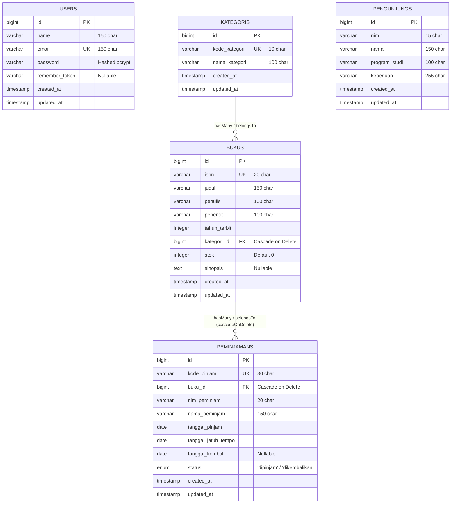

# Sistem Informasi Perpustakaan Kampus Del (SIPUS-Del)
**Praktikum Pemrograman & Pengujian Web (12S3101) — Modul Minggu 06 (Tahap 2)**  
*Institut Teknologi Del • Semester Ganjil 2026/2027*

---

## 📌 Ringkasan Proyek (Tahap 2)

**SIPUS-Del Tahap 2** merupakan kelanjutan pengembangan aplikasi manajemen inventaris perpustakaan kampus berbasis **Laravel 11.x**. Pada tahap ini, sistem ditingkatkan dengan kapabilitas:
1. **Konektivitas Basis Data Persisten & Abstraksi PDO**: Pemanfaatan koneksi persisten relasional dengan proteksi mutlak dari serangan *SQL Injection* melalui protokol dua fase (*Prepared Statements & Parameter Binding*).
2. **Transaksi Sirkulasi Buku Berbasis ACID & Pessimistic Locking**: Operasi peminjaman dan pengembalian buku dibungkus dalam `DB::transaction()` terisolasi dengan penguncian baris `lockForUpdate()` (`SELECT ... FOR UPDATE`), menjamin stok buku tidak pernah bernilai minus (*Race Condition Mitigation*) dan mencegah peminjaman ganda oleh mahasiswa yang sama.
3. **Fluent Query Builder (`DB::table`) & Agregasi `withCount`**: Pembuatan kartu analitik statistik perpustakaan menggunakan agregasi langsung `DB::table()` serta optimasi katalog buku menggunakan `withCount('peminjamans')` dan Eager Loading `with('kategori')` guna meniadakan *N+1 Query Problem*.
4. **Manajemen Sesi Pengguna & Autentikasi Aman**: Implementasi autentikasi Pustakawan via `Auth::attempt()`, regenerasi session ID (`session()->regenerate()`) anti-*Session Fixation*, penutupan sesi yang aman (`invalidate()` dan `regenerateToken()`), serta pelacakan cookie klien melalui `Cookie::queue()` dengan atribut keamanan `HttpOnly` dan `SameSite`.

---

## 🔐 Kredensial Akun Uji Pustakawan

Sesuai instruksi modul praktikum, berikut kredensial akun uji untuk hak akses manajemen pustakawan:

| Parameter | Kredensial Uji | Keterangan |
| :--- | :--- | :--- |
| **Email Pustakawan** | `pustakawan@del.ac.id` | Akun pustakawan baku dari seeder |
| **Kata Sandi** | `password123` | Terenkripsi dengan algoritma `bcrypt` |
| **Role / Hak Akses** | Administrator / Pustakawan | Hak akses penuh: Tambah/Edit/Hapus Buku & Kategori, Transaksi Sirkulasi Peminjaman & Pengembalian |

---

## 🏗️ Skema Relasi Basis Data (ERD)



---

## 🚦 Matriks Endpoint, Routing & Hak Akses

| Method | Endpoint URI | Route Name | Middleware | Controller Action | Deskripsi & Hak Akses |
| :--- | :--- | :--- | :--- | :--- | :--- |
| `GET` | `/` | - | Public | - | Pengalihan otomatis ke `buku.index` |
| `GET` | `/buku` | `buku.index` | Public | `BukuController@index` | Katalog buku publik, filter `when()`, 4 stat cards `DB::table` |
| `GET` | `/buku/{buku}` | `buku.show` | Public | `BukuController@show` | Rincian metadata buku & ketersediaan stok |
| `GET` | `/kategori` | `kategori.index` | Public | `KategoriController@index` | Daftar kategori buku beserta jumlah koleksi buku |
| `GET` | `/kategori/{kategori}` | `kategori.show` | Public | `KategoriController@show` | Rincian kategori beserta koleksi buku di dalamnya |
| `GET` | `/pengunjung` | `pengunjung.index` | Public | `PengunjungController@index` | Rekapitulasi log kehadiran pengunjung perpustakaan |
| `GET` | `/pengunjung/create` | `pengunjung.create` | Public | `PengunjungController@create` | Form buku tamu digital pemustaka |
| `POST` | `/pengunjung` | `pengunjung.store` | Public | `PengunjungController@store` | Simpan data presensi pengunjung |
| `GET` | `/login` | `login` | Guest | `AuthController@showLoginForm` | Form login pustakawan (membaca cookie email) |
| `POST` | `/login` | - | Guest | `AuthController@login` | Validasi kredensial, regenerasi sesi, set cookie |
| `POST` | `/logout` | `logout` | Auth | `AuthController@logout` | Hapus sesi server, invalidate token CSRF |
| `GET` | `/buku/create` | `buku.create` | `auth` | `BukuController@create` | Formulir tambah judul buku baru |
| `POST` | `/buku` | `buku.store` | `auth` | `BukuController@store` | Simpan buku baru ke inventaris |
| `GET` | `/buku/{buku}/edit` | `buku.edit` | `auth` | `BukuController@edit` | Formulir modifikasi informasi buku |
| `PUT` | `/buku/{buku}` | `buku.update` | `auth` | `BukuController@update` | Simpan perubahan data buku |
| `DELETE` | `/buku/{buku}` | `buku.destroy` | `auth` | `BukuController@destroy` | Hapus buku dari katalog perpustakaan |
| `GET` | `/kategori/create` | `kategori.create` | `auth` | `KategoriController@create` | Formulir penambahan kategori baru |
| `POST` | `/kategori` | `kategori.store` | `auth` | `KategoriController@store` | Simpan kategori baru |
| `GET` | `/kategori/{kategori}/edit`| `kategori.edit` | `auth` | `KategoriController@edit` | Formulir ubah kategori |
| `PUT` | `/kategori/{kategori}` | `kategori.update` | `auth` | `KategoriController@update` | Simpan pembaruan kategori |
| `DELETE` | `/kategori/{kategori}` | `kategori.destroy` | `auth` | `KategoriController@destroy` | Hapus kategori (cascade ke buku terkait) |
| `GET` | `/peminjaman` | `peminjaman.index` | `auth` | `PeminjamanController@index` | Daftar sirkulasi peminjaman aktif & riwayat |
| `GET` | `/peminjaman/create` | `peminjaman.create` | `auth` | `PeminjamanController@create` | Formulir transaksi peminjaman buku |
| `POST` | `/peminjaman` | `peminjaman.store` | `auth` | `PeminjamanController@store` | **ACID Transaction:** Kunci baris, mutasi stok & buat pinjaman |
| `GET` | `/peminjaman/{peminjaman}` | `peminjaman.show` | `auth` | `PeminjamanController@show` | Rincian bukti transaksi peminjaman |
| `POST` | `/peminjaman/{id}/kembali` | `peminjaman.kembali` | `auth` | `PeminjamanController@kembali` | **ACID Transaction:** Kunci baris, ubah status & pulihkan stok |

---

## ⚡ Implementasi Transaksi Basis Data (ACID) & Pessimistic Locking

### 1. Peminjaman Buku Atomik (`PeminjamanController@store`)
Operasi peminjaman buku dibungkus dalam `DB::transaction()` dengan proteksi *Pessimistic Locking* tingkat baris:
```php
DB::transaction(function () use ($validated) {
    // 1. Kunci baris buku secara eksklusif (SELECT ... FOR UPDATE)
    $buku = Buku::where('id', $validated['buku_id'])->lockForUpdate()->firstOrFail();

    // 2. Evaluasi stok atomik: cegah stok bernilai minus
    if ($buku->stok < 1) {
        throw new \RuntimeException("Stok buku '{$buku->judul}' telah habis (0). Peminjaman tidak dapat diproses!");
    }

    $nim = strtoupper(trim($validated['nim_peminjam']));

    // 3. Pencegahan duplikasi pinjaman aktif untuk NIM yang sama
    $sedangPinjam = Peminjaman::where('buku_id', $buku->id)
        ->where('nim_peminjam', $nim)
        ->where('status', 'dipinjam')
        ->lockForUpdate()
        ->exists();

    if ($sedangPinjam) {
        throw new \RuntimeException("Mahasiswa dengan NIM {$nim} masih memiliki pinjaman aktif untuk buku ini!");
    }

    // 4. Pengurangan stok secara atomik
    $buku->decrement('stok');

    // 5. Pencatatan transaksi peminjaman
    return Peminjaman::create([ ... ]);
}, 3);
```

### 2. Pengembalian Buku Atomik (`PeminjamanController@kembali`)
```php
DB::transaction(function () use ($id) {
    // 1. Kunci baris peminjaman
    $pinjam = Peminjaman::where('id', $id)->lockForUpdate()->firstOrFail();
    if ($pinjam->status === 'dikembalikan') {
        throw new \RuntimeException("Transaksi ini sudah pernah dikembalikan!");
    }

    // 2. Kunci baris buku terkait
    $buku = Buku::where('id', $pinjam->buku_id)->lockForUpdate()->firstOrFail();

    // 3. Ubah status dan tanggal kembali
    $pinjam->update([
        'status' => 'dikembalikan',
        'tanggal_kembali' => now()->toDateString(),
    ]);

    // 4. Kembalikan kuota stok buku
    $buku->increment('stok');
}, 3);
```

---

## 📊 Fluent Query Builder (`DB::table`) & Optimasi Kueri

### 1. Dashboard Kartu Analitik Statistik
Agregasi statistik dieksekusi cepat menggunakan **Fluent Query Builder (`DB::table`)**:
```php
$stats = [
    'total_judul' => DB::table('bukus')->count(),
    'total_stok' => (int) DB::table('bukus')->sum('stok'),
    'total_dipinjam' => DB::table('peminjamans')->where('status', 'dipinjam')->count(),
    'total_dikembalikan' => DB::table('peminjamans')->where('status', 'dikembalikan')->count(),
];
```

### 2. Agregasi `withCount` & Pencegahan N+1 Query
Katalog buku memuat jumlah riwayat peminjaman per buku secara efisien via subquery SQL:
```php
$bukus = Buku::with('kategori')
    ->withCount('peminjamans')
    ->when($request->search, function ($query, $search) {
        return $query->where(function ($q) use ($search) {
            $q->where('judul', 'like', "%{$search}%")
              ->orWhere('penulis', 'like', "%{$search}%")
              ->orWhere('isbn', 'like', "%{$search}%");
        });
    })
    ->when($request->kategori_id, fn($q, $id) => $q->where('kategori_id', $id))
    ->latest()
    ->paginate(10)
    ->withQueryString();
```

---

## 🛡️ Manajemen Sesi Pengguna & Keamanan HTTP Cookie

1. **Mitigasi Session Fixation**: Setiap kali pustakawan berhasil login, sistem memanggil `$request->session()->regenerate()` untuk memperbarui identifier sesi acak di sisi server.
2. **Penutupan Sesi Bersih**: Saat logout, dipanggil `$request->session()->invalidate()` dan `$request->session()->regenerateToken()`.
3. **Penyimpanan State Sesi**:
   - `last_buku_search`: Menyimpan kata kunci pencarian terakhir di katalog.
   - `last_borrower_nim` & `last_borrower_name`: Mengingat identitas pemustaka terakhir untuk mempercepat input berulang.
   - `login_timestamp`: Mencatat waktu presisi sesi aktif pustakawan.
4. **Keamanan Cookie Klien (`Cookie::queue`)**:
   - Cookie `del_last_librarian_email` disimpan dengan masa berlaku 7 hari (10.080 menit).
   - Dilindungi flag **`HttpOnly`** (tidak dapat dibaca/dicuri oleh skrip JavaScript klien mitigasi XSS) dan **`SameSite=Lax`** (mitigasi serangan CSRF).

---

## 🧪 Bukti Pengujian Sistem & Verifikasi Hasil

### 1. Pengujian Transaksi ACID & Bukti Rollback Saat Stok = 0
Disediakan buku uji dengan **Stok = 0**:
- **Judul**: *Sistem Terdistribusi & Algoritma Konsensus ACID* (ISBN: `978-602-0000-00-1`).

**Hasil Eksekusi Uji Transaksi:**
```text
=== TEST 1: PENGUJIAN PENOLAKAN TRANSAKSI PADA BUKU STOK = 0 (ROLLBACK OTOMATIS) ===
Memilih buku stok 0: ID 21 - Sistem Terdistribusi & Algoritma Konsensus ACID (Stok: 0)
BERHASIL: Transaksi berhasil ditolak & di-rollback!
Pesan Exception: Stok buku 'Sistem Terdistribusi & Algoritma Konsensus ACID' telah habis (0). Peminjaman tidak dapat diproses!
Verifikasi Stok Akhir Buku: 0 (Tetap 0, tidak minus)

=== TEST 2: PENGUJIAN TRANSAKSI PEMINJAMAN BERHASIL (ACID MUTASI ATOMIK) ===
Buku: Pemrograman Web Lanjut (Stok Awal: 34)
BERHASIL: Peminjaman dibuat dengan Kode: PJ-TEST-YKZG. Stok berkurang dari 34 menjadi 33

=== TEST 3: PENGUJIAN PENCEGAHAN NIM GANDA PADA PINJAMAN AKTIF ===
BERHASIL: Peminjaman ganda berhasil dicegah!
Pesan Exception: Mahasiswa dengan NIM 12S24099 masih memiliki pinjaman aktif untuk buku ini!

=== TEST 4: PENGUJIAN PENGEMBALIAN BUKU SECARA ATOMIK ===
BERHASIL: Pengembalian selesai. Status: dikembalikan, Tgl Kembali: 2026-10-14, Stok Pulih Menjadi: 34
```

### 2. Bukti Audit Cookie Browser DevTools (Application Tab)

Header respons HTTP saat pustakawan login:
```http
Set-Cookie: del_last_librarian_email=pustakawan%40del.ac.id; expires=Wed, 21 Oct 2026 14:15:00 GMT; Max-Age=604800; path=/; httponly; samesite=lax
Set-Cookie: laravel_session=eyJpdiI6...; expires=Wed, 14 Oct 2026 16:15:00 GMT; Max-Age=7200; path=/; httponly; samesite=lax
```
> **Verifikasi DevTools:**
> - Kolom **HttpOnly** bertanda centang (`true`), memastikan keamanan dari serangan *Cross-Site Scripting* (XSS).
> - Kolom **SameSite** bernilai `Lax`, memastikan proteksi dari *Cross-Site Request Forgery* (CSRF).

---

## ⚙️ Panduan Menjalankan Proyek

1. **Pindah ke Direktori Proyek & Checkout Branch:**
   ```bash
   cd sipus-del
   git checkout week6-db-session
   ```

2. **Migrasi Database & Injeksi Data Seeder Baku:**
   ```bash
   php artisan migrate:fresh --seed
   ```
   *Perintah ini otomatis membangun tabel `users`, `kategoris`, `bukus`, `peminjamans`, dan `pengunjungs` serta menyuntikkan akun pustakawan uji, buku stok 0 & 1, dan riwayat peminjaman.*

3. **Jalankan Server Lokal:**
   ```bash
   php artisan serve
   ```
   Buka peramban di `http://127.0.0.1:8000`.

4. **Login Pustakawan:**
   - Akses `/login` atau klik menu **Login Pustakawan**.
   - Masukkan `pustakawan@del.ac.id` dan sandi `password123`.

---

## 📋 Checklist Rubrik Penilaian Modul Minggu 06

- [x] **1. Konektivitas DB & Migrasi Peminjamans (20%)**: Skema tabel `peminjamans` lengkap, foreign key constrained dengan `cascadeOnDelete`, Model `Peminjaman` & relasi `Buku <-> Peminjaman` presisi.
- [x] **2. Transaksi Basis Data ACID & Concurrency Locking (25%)**: Sirkulasi peminjaman & pengembalian dibungkus `DB::transaction()` + `lockForUpdate()`, pencegahan stok minus / penolakan stok 0 tertangani, proteksi NIM ganda, dan logging `QueryException`.
- [x] **3. Fluent Query Builder, Agregasi withCount, & Filter Dinamis (15%)**: 4 Kartu statistik menggunakan `DB::table()`, katalog buku menggunakan `withCount('peminjamans')` bebas $N+1$, pencarian dinamis `when()`, dan paginasi `withQueryString()`.
- [x] **4. Manajemen Sesi Pengguna & Autentikasi Pustakawan (25%)**: Login/Logout aman via `AuthController`, regenerasi sesi `session()->regenerate()` (anti-*Session Fixation*), seluruh rute mutasi diproteksi middleware `auth`, session state aktif, dan HTTP Cookie persisten (`HttpOnly` & `SameSite`).
- [x] **5. Seeder, Bukti Pengujian Transaksi ACID, & Dokumentasi (15%)**: Seeder akun pustakawan (`pustakawan@del.ac.id`), sampel buku stok = 0 dan stok = 1, sampel transaksi, dokumentasi ERD lengkap, bukti uji rollback, dan audit cookie.

---
*Dikembangkan oleh Arion Manurung (12S24014) untuk Praktikum Pemrograman & Pengujian Web — Institut Teknologi Del.*
