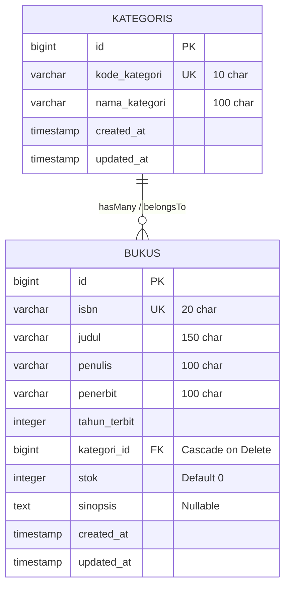

# Sistem Informasi Perpustakaan Kampus Del (SIPUS-Del)
**Praktikum Pemrograman & Pengujian Web (12S3101) — Modul Minggu 05**  
*Institut Teknologi Del • Semester Ganjil 2026/2027*

---

## 📌 Ringkasan Proyek

**SIPUS-Del** adalah aplikasi web manajemen inventaris buku perpustakaan kampus berbasis Laravel 11.x. Proyek ini dibangun dengan menerapkan standar pola arsitektur **Model-View-Controller (MVC) Server-Side Rendering (SSR)**, perlindungan keamanan ketat (CSRF, validasi masukan server-side, sanitasi XSS), integrasi relasi **Eloquent ORM** One-to-Many dengan optimasi **Eager Loading** guna memitigasi *N+1 Query Problem*, serta antarmuka modular memanfaatkan **Blade Components** bertema *Del Royal Purple* (`#4C1D95`).

---

## 🏗️ Arsitektur & Spesifikasi Teknis

### 1. Pola Arsitektur MVC & Pemisahan Tanggung Jawab (*Separation of Concerns*)
* **Model (`app/Models/`)**:
  * `Kategori.php`: Merepresentasikan tabel `kategoris` dengan relasi `hasMany(Buku::class)` dan proteksi mass assignment `$fillable = ['kode_kategori', 'nama_kategori']`.
  * `Buku.php`: Merepresentasikan tabel `bukus` dengan relasi `belongsTo(Kategori::class)` dan proteksi mass assignment `$fillable = ['isbn', 'judul', 'penulis', 'penerbit', 'tahun_terbit', 'kategori_id', 'stok', 'sinopsis']`.
* **Controller (`app/Http/Controllers/`)**:
  * `KategoriController.php`: Menangani 7 aksi standar RESTful Resource (`index`, `create`, `store`, `show`, `edit`, `update`, `destroy`) dengan *Implicit Route Model Binding*.
  * `BukuController.php`: Menangani 7 aksi standar RESTful Resource buku dengan validasi form server-side dan eager loading.
* **View (`resources/views/`)**:
  * Master Shell Layout `<x-layout>` pada `resources/views/components/layout.blade.php`.
  * Direktif aman Blade `@forelse`, `@csrf`, `@method('PUT')`, `@method('DELETE')`, serta paginasi Bootstrap 5.

---

### 2. Skema Relasi Basis Data (Migrations)



---

### 3. Matriks Endpoint & Routing RESTful

| Method | Endpoint URI | Route Name | Controller Action | Keterangan |
| :--- | :--- | :--- | :--- | :--- |
| `GET` | `/` | - | `redirect('buku.index')` | Pengalihan ke halaman katalog utama |
| `GET` | `/buku` | `buku.index` | `BukuController@index` | Daftar seluruh koleksi buku (Eager Loaded + Paginasi) |
| `GET` | `/buku/create` | `buku.create` | `BukuController@create` | Formulir tambah buku baru |
| `POST` | `/buku` | `buku.store` | `BukuController@store` | Simpan data buku baru ke basis data |
| `GET` | `/buku/{buku}` | `buku.show` | `BukuController@show` | Rincian detail metadata buku & kategori |
| `GET` | `/buku/{buku}/edit` | `buku.edit` | `BukuController@edit` | Formulir ubah data buku |
| `PUT/PATCH` | `/buku/{buku}` | `buku.update` | `BukuController@update` | Simpan pembaruan buku ke basis data |
| `DELETE` | `/buku/{buku}` | `buku.destroy` | `BukuController@destroy` | Hapus buku dari katalog |
| `GET` | `/kategori` | `kategori.index` | `KategoriController@index` | Daftar kategori buku (dengan `withCount`) |
| `GET` | `/kategori/create` | `kategori.create` | `KategoriController@create` | Formulir tambah kategori |
| `POST` | `/kategori` | `kategori.store` | `KategoriController@store` | Simpan kategori baru ke basis data |
| `GET` | `/kategori/{kategori}` | `kategori.show` | `KategoriController@show` | Rincian kategori beserta daftar bukunya |
| `GET` | `/kategori/{kategori}/edit` | `kategori.edit` | `KategoriController@edit` | Formulir edit kategori |
| `PUT/PATCH` | `/kategori/{kategori}` | `kategori.update` | `KategoriController@update` | Simpan pembaruan kategori |
| `DELETE` | `/kategori/{kategori}` | `kategori.destroy` | `KategoriController@destroy` | Hapus kategori |
| `GET` | `/pengunjung` | `pengunjung.index` | `PengunjungController@index` | Daftar & ringkasan statistik log pengunjung |
| `GET` | `/pengunjung/create` | `pengunjung.create` | `PengunjungController@create` | Formulir buku tamu kehadiran pengunjung |
| `POST` | `/pengunjung` | `pengunjung.store` | `PengunjungController@store` | Simpan catatan kehadiran ke basis data |
| `GET` | `/pengunjung/{pengunjung}` | `pengunjung.show` | `PengunjungController@show` | Rincian detail kehadiran pemustaka |
| `DELETE` | `/pengunjung/{pengunjung}` | `pengunjung.destroy` | `PengunjungController@destroy` | Hapus catatan log pengunjung |

---

### 4. Mitigasi N+1 Problem & Bukti Audit SQL

Pada `BukuController::index()`, kueri data buku dieksekusi menggunakan **Eager Loading**:
```php
$bukus = Buku::with('kategori')->latest()->paginate(10);
```

Melalui listener `DB::listen` pada `AppServiceProvider.php`, seluruh kueri yang dieksekusi tercatat di `storage/logs/laravel.log`:

```log
[2026-10-10 04:13:02] local.INFO: [SQL AUDIT] (1.43 ms) select count(*) as aggregate from "bukus" | Bindings: []
[2026-10-10 04:13:02] local.INFO: [SQL AUDIT] (0.69 ms) select * from "bukus" order by "created_at" desc limit 10 offset 0 | Bindings: []
[2026-10-10 04:13:02] local.INFO: [SQL AUDIT] (0.52 ms) select * from "kategoris" where "kategoris"."id" in (1, 2, 3, 4, 5) | Bindings: [1, 2, 3, 4, 5]
```

> **Analisis:** Mengambil 10 data buku beserta relasi kategorinya hanya memerlukan **2 kueri data terpadu** (ditambah 1 kueri agregat hitung total paginasi), membuktikan bahwa masalah performa $N+1$ kueri telah berhasil dicegah secara optimal.

---

## ⚙️ Panduan Instalasi & Menjalankan Proyek

Pastikan lingkungan lokal Anda memenuhi prasyarat:
* **PHP Runtime**: PHP >= 8.2 (ekstensi aktif: `pdo_sqlite`, `mbstring`, `openssl`, `xml`, `curl`)
* **Composer**: Composer >= 2.6.x

### Langkah-langkah Menjalankan:

1. **Clone Repositori:**
   ```bash
   git clone https://github.com/[username]/ppw-2026-week5-[NIM].git
   cd ppw-2026-week5-[NIM]/sipus-del
   ```

2. **Pasang Dependensi PHP:**
   ```bash
   composer install
   ```

3. **Konfigurasi Environment:**
   ```bash
   cp .env.example .env
   php artisan key:generate
   ```

4. **Eksekusi Migrasi & Mock Seeding (Faker):**
   ```bash
   php artisan migrate:fresh --seed
   ```
   *Perintah ini otomatis membangun tabel `kategoris` & `bukus` serta menyuntikkan 5 kategori baku dan 20+ buku uji.*

5. **Jalankan Development Server:**
   ```bash
   php artisan serve
   ```
   Buka peramban di `http://localhost:8000` untuk mengakses aplikasi SIPUS-Del.

---

## 📋 Checklist Rubrik Penilaian Praktikum

- [x] **Arsitektur MVC & Routing RESTful (20%)**: Pemisahan Model, View, Controller; 7 aksi RESTful terdaftar via `Route::resource`; Route Model Binding aktif.
- [x] **Model Relasional & Eloquent ORM (25%)**: Skema tabel relasional berversi, relasi One-to-Many `hasMany` & `belongsTo`, `$fillable` terproteksi, Eager Loading (`with('kategori')`).
- [x] **Validasi Input & Keamanan Web (20%)**: Validasi server-side via `$request->validate()`, proteksi token `@csrf`, sanitasi Blade `{{ }}`, method spoofing `@method('PUT')` dan `@method('DELETE')`.
- [x] **Blade Templating & Desain UI (20%)**: Master layout `<x-layout>` bernuansa Del Royal Purple (`#4C1D95`), status flash alert dinamis, paginasi Bootstrap 5 aktif, empty state handling `@forelse`.
- [x] **Seeders, Logging, Git & Laporan (15%)**: Seeder 5 kategori & 20 data buku realistis dengan Faker, audit logging `[SQL AUDIT]` di `AppServiceProvider`, dokumentasi panduan lengkap.

---
*Dikembangkan untuk Praktikum Pemrograman & Pengujian Web — Institut Teknologi Del.*
